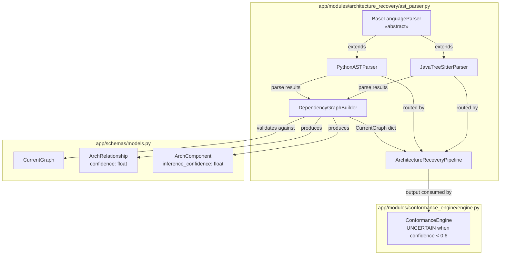

# Design Document — Sprint 2 P3: Multi-Language Static Analysis, Confidence Scoring & CI

## Overview

Sprint 2 P3 extends the ArchLens backend with three concrete deliverables:

1. **Multi-language parser abstraction** — a `BaseLanguageParser` ABC that both `PythonASTParser` (refactored) and the new `JavaTreeSitterParser` implement, enforcing a common `ParseResult` schema so that `DependencyGraphBuilder` and `ArchitectureRecoveryPipeline` are language-agnostic.

2. **Java static analysis via tree-sitter** — `JavaTreeSitterParser` uses the `tree-sitter==0.23.2` API with the `tree-sitter-java` grammar to extract classes, imports, methods, and package declarations, producing a `ParseResult` dict structurally identical to the Python parser output.

3. **Graph confidence scoring** — `DependencyGraphBuilder` gains three-tier edge confidence (1.0 / 0.8 / 0.5) and per-node `inference_confidence` (1.0 / 0.6), which feeds directly into the existing `ConformanceEngine` `UNCERTAIN` verdict at the 0.6 threshold.

All new code is covered by `test_java_parser.py` and `test_confidence_metrics.py`, and a GitHub Actions CI workflow enforces pytest + ruff on every push and PR to `main` and `Bhumika`.

### Sprint 1 Foundation (unchanged contracts)

The following Sprint 1 components are extended but their public API contracts are preserved:

| Component | Sprint 1 contract | Sprint 2 P3 change |
|---|---|---|
| `PythonASTParser` | `parse_file`, `parse_directory` | Refactored to extend `BaseLanguageParser`; output unchanged |
| `DependencyGraphBuilder` | `build_from_python`, `_add_edge`, `_infer_component_type` | Extended with `build_from_java`, confidence tiers |
| `ArchitectureRecoveryPipeline` | `analyze_repository(repo, language="python")` | Extended with `language="java"` and `language="mixed"` |
| `ConformanceEngine` | UNCERTAIN verdict fires when `confidence < threshold` | No change — already implemented |

---

## Architecture

### Component Diagram



### Data Flow

```
repo_path
    │
    ▼
ArchitectureRecoveryPipeline.analyze_repository(repo_path, language)
    │
    ├─ language="python"  → PythonASTParser.parse_directory()
    ├─ language="java"    → JavaTreeSitterParser.parse_directory()
    └─ language="mixed"   → both parsers, results merged
    │
    ▼
List[ParseResult]   ← common schema: {file, classes, imports, methods, metadata, ...}
    │
    ▼
DependencyGraphBuilder.build_from_python() / build_from_java()
    ├─ Exact match import    → edge confidence = 1.0
    ├─ Partial match import  → edge confidence = 0.8
    └─ Ambiguous import      → edge confidence = 0.5
    │
    ├─ Keyword match type    → node inference_confidence = 1.0
    └─ Default MODULE type   → node inference_confidence = 0.6
    │
    ▼
CurrentGraph dict  (validates against CurrentGraph Pydantic schema)
    │
    ▼
ConformanceEngine.check_conformance()
    └─ edge.confidence < 0.6  → verdict UNCERTAIN
```

---

## Components and Interfaces

### 1. `BaseLanguageParser` (ABC)

**File:** `backend/app/modules/architecture_recovery/ast_parser.py`

```python
from abc import ABC, abstractmethod
from typing import List, Dict, Any

class BaseLanguageParser(ABC):
    """Abstract base class for all language-specific source parsers.
    
    Every subclass MUST implement the three abstract methods below.
    Python's ABC mechanism enforces this at instantiation time — any
    incomplete subclass raises TypeError.
    """

    @abstractmethod
    def parse_file(self, path: str) -> Dict[str, Any]:
        """Parse a single source file and return a ParseResult dict.
        
        On success: returns ParseResult (see schema below).
        On failure: returns {"file": path, "error": "<description>"}
                    WITHOUT raising an exception.
        """

    @abstractmethod
    def parse_directory(self, path: str) -> List[Dict[str, Any]]:
        """Recursively parse all supported files under `path`.
        
        Returns a list of ParseResult dicts, one per file.
        Ignores .git, target, build, __pycache__ directories.
        """

    @abstractmethod
    def supported_extensions(self) -> List[str]:
        """Return the list of file extensions this parser handles.
        
        Example: [".py"] for PythonASTParser, [".java"] for JavaTreeSitterParser.
        """
```

**ParseResult schema** (common to all parsers):

```python
ParseResult = TypedDict("ParseResult", {
    "file":     str,                    # Absolute or relative file path
    "classes":  List[Dict[str, Any]],   # [{name, bases, line, decorators}, ...]
    "imports":  List[str],              # Flat list of fully-qualified import strings
    "methods":  List[str],              # Flat list of method/function name strings
    "metadata": Dict[str, Any],         # Parser-specific extra data
    # Python-only additional keys (compatible; absent keys default to []):
    "from_imports":     List[Dict],     # [{module, names, level}, ...]
    "function_calls":   List[str],      # Python call expressions
    "functions":        List[str],      # Python top-level functions (mirrors methods)
    # Java-only additional keys:
    "package": str,                     # Java package declaration, "" if absent
})
```

> **Compatibility note:** `DependencyGraphBuilder` only reads `file`, `classes`, `imports`, and `methods` from the ParseResult. The extra language-specific keys (`from_imports`, `function_calls`, `package`) are transparent to the graph builder, so no conditional branching on language is needed.

---

### 2. `PythonASTParser` (refactored)

**File:** `backend/app/modules/architecture_recovery/ast_parser.py`

```python
class PythonASTParser(BaseLanguageParser):
    """Python source parser — unchanged behaviour, now extends BaseLanguageParser."""

    def supported_extensions(self) -> List[str]:
        return [".py"]

    def parse_file(self, path: str) -> Dict[str, Any]:
        # Identical to Sprint 1 implementation.
        # Returns: {file, classes, imports, from_imports, function_calls, functions}
        ...

    def parse_directory(self, path: str) -> List[Dict[str, Any]]:
        # Identical to Sprint 1 implementation.
        # Ignores: .venv, venv, __pycache__, .git, .pytest_cache
        ...
```

No logic changes — only the class declaration adds `(BaseLanguageParser)`. All 18 Sprint 1 tests continue to pass.

---

### 3. `JavaTreeSitterParser`

**File:** `backend/app/modules/architecture_recovery/ast_parser.py`

```python
from tree_sitter import Language, Parser
import tree_sitter_java as tsjava

class JavaTreeSitterParser(BaseLanguageParser):
    """Java source parser using tree-sitter 0.23.2 + tree-sitter-java grammar."""

    # Class-level singleton to avoid repeated Language/Parser construction
    _language: Optional[Language] = None
    _parser: Optional[Parser] = None

    @classmethod
    def _get_parser(cls) -> Parser:
        """Lazy-initialise the tree-sitter Language and Parser (thread-safe enough for tests)."""
        if cls._parser is None:
            cls._language = Language(tsjava.language())
            cls._parser = Parser()
            cls._parser.set_language(cls._language)
        return cls._parser

    def supported_extensions(self) -> List[str]:
        return [".java"]

    def parse_file(self, path: str) -> Dict[str, Any]:
        """Parse a single .java file using tree-sitter.
        
        Returns ParseResult dict on success; {"file": path, "error": str} on failure.
        """
        try:
            with open(path, "rb") as f:           # tree-sitter needs bytes
                source_bytes = f.read()
        except OSError as e:
            return {"file": path, "error": f"Cannot read file: {e}"}

        try:
            parser = self._get_parser()
            tree = parser.parse(source_bytes)
        except Exception as e:
            return {"file": path, "error": f"tree-sitter parse error: {e}"}

        visitor = _JavaTreeSitterVisitor(source_bytes)
        visitor.visit(tree.root_node)

        return {
            "file":     path,
            "classes":  visitor.classes,    # [{name, bases, line, decorators}, ...]
            "imports":  visitor.imports,    # ["com.example.OrderService", ...]
            "methods":  visitor.methods,    # ["createOrder", "findById", ...]
            "package":  visitor.package,    # "com.example.controllers" or ""
            "metadata": {
                "source_language": "java",
                "node_count": tree.root_node.child_count,
            },
        }

    def parse_directory(self, path: str) -> List[Dict[str, Any]]:
        """Recursively parse all .java files under `path`.
        
        Ignored directory names: .git, target, build, __pycache__
        """
        _IGNORE = {".git", "target", "build", "__pycache__"}
        results = []
        for java_file in Path(path).rglob("*.java"):
            if any(part in _IGNORE for part in java_file.parts):
                continue
            results.append(self.parse_file(str(java_file)))
        return results
```

#### `_JavaTreeSitterVisitor`

```python
class _JavaTreeSitterVisitor:
    """Walks a tree-sitter Java AST and extracts architectural entities."""

    def __init__(self, source_bytes: bytes):
        self._src = source_bytes
        self.classes:  List[Dict[str, Any]] = []
        self.imports:  List[str] = []
        self.methods:  List[str] = []
        self.package:  str = ""

    def _text(self, node) -> str:
        """Extract UTF-8 text for a node from source bytes."""
        return self._src[node.start_byte:node.end_byte].decode("utf-8", errors="replace")

    def visit(self, node) -> None:
        """Recursive DFS traversal of the tree-sitter node tree."""
        handler = getattr(self, f"_visit_{node.type}", None)
        if handler:
            handler(node)
        for child in node.children:
            self.visit(child)

    def _visit_package_declaration(self, node) -> None:
        # Grammar: package_declaration → "package" scoped_identifier ";"
        for child in node.children:
            if child.type in ("scoped_identifier", "identifier"):
                self.package = self._text(child)
                return

    def _visit_import_declaration(self, node) -> None:
        # Grammar: import_declaration → "import" ("static")? scoped_identifier ("." "*")? ";"
        for child in node.children:
            if child.type in ("scoped_identifier", "identifier"):
                self.imports.append(self._text(child))
                return

    def _visit_class_declaration(self, node) -> None:
        # Grammar: class_declaration → modifiers? "class" identifier
        #          superclass? super_interfaces? class_body
        name = ""
        bases: List[str] = []
        decorators: List[str] = []
        line = node.start_point[0] + 1  # tree-sitter rows are 0-indexed

        for child in node.children:
            if child.type == "identifier":
                name = self._text(child)
            elif child.type == "superclass":
                # superclass → "extends" type_identifier
                for sc in child.children:
                    if sc.type == "type_identifier":
                        bases.append(self._text(sc))
            elif child.type == "super_interfaces":
                # super_interfaces → "implements" type_list
                for si in child.children:
                    if si.type == "type_list":
                        for iface in si.children:
                            if iface.type == "type_identifier":
                                bases.append(self._text(iface))
            elif child.type == "modifiers":
                # Collect annotations as decorators
                for mod in child.children:
                    if mod.type == "marker_annotation" or mod.type == "annotation":
                        decorators.append(self._text(mod))

        if name:
            self.classes.append({
                "name":       name,
                "bases":      bases,
                "line":       line,
                "decorators": decorators,
            })

    def _visit_method_declaration(self, node) -> None:
        # Grammar: method_declaration → modifiers? type_identifier identifier formal_parameters ...
        for child in node.children:
            if child.type == "identifier":
                self.methods.append(self._text(child))
                return
```

**tree-sitter 0.23.2 API notes:**

- `Language(tsjava.language())` — the 0.23.x constructor takes a capsule object from `tree_sitter_java.language()`, not a `.so` path.
- `Parser.set_language(lang)` — required before calling `parse()`.
- `parser.parse(bytes)` → `Tree`; `tree.root_node` → root `Node`.
- Node fields: `node.type` (grammar rule name), `node.children` (list), `node.start_point` (row, col 0-indexed), `node.start_byte` / `node.end_byte`.
- `requirements.txt` additions needed: `tree-sitter-java` (grammar package, install alongside `tree-sitter==0.23.2`).

---

### 4. `DependencyGraphBuilder` — Extended

**File:** `backend/app/modules/architecture_recovery/ast_parser.py`

#### New: `build_from_java`

```python
def build_from_java(
    self, parsed_files: List[Dict[str, Any]], repo_root: str
) -> Dict[str, Any]:
    """Build dependency graph from parsed Java files.
    
    Produces a CurrentGraph-compatible dict equivalent in structure
    to the output of build_from_python().
    """
    repo_root_path = Path(repo_root).resolve()
    self.nodes = {}
    self.edges = []

    # First pass: register all internal Java modules
    module_file_map: Dict[str, str] = {}
    for file_data in parsed_files:
        if "error" in file_data:
            continue
        file_path = file_data["file"]
        module_name = self._path_to_module(file_path, repo_root_path)
        module_file_map[module_name] = file_path

        comp_type = self._infer_component_type(module_name, file_data)
        keyword_match = comp_type != ComponentType.MODULE.value
        inference_confidence = 1.0 if keyword_match else 0.6

        self.nodes[module_name] = {
            "id":   module_name,
            "name": Path(file_path).stem,
            "type": comp_type,
            "file": file_path,
            "classes": [c["name"] for c in file_data.get("classes", [])],
            "inference_confidence": inference_confidence,
            "metadata": {
                "package": file_data.get("package", ""),
                "classes_full": file_data.get("classes", []),
                "methods": file_data.get("methods", []),
                "source_language": "java",
            },
        }

    # Second pass: resolve import dependencies with confidence scoring
    for file_data in parsed_files:
        if "error" in file_data:
            continue
        file_path = file_data["file"]
        source_module = self._path_to_module(file_path, repo_root_path)

        for imp in file_data.get("imports", []):
            target_module, confidence = self._resolve_java_import(
                imp, module_file_map
            )
            if target_module and target_module != source_module:
                self._add_edge_with_confidence(
                    source_module, target_module,
                    RelationshipType.DEPENDS_ON.value,
                    confidence
                )

    return {
        "schema_version": "1.0.0",
        "id": f"gc-{repo_root_path.name}",
        "name": repo_root_path.name or "RecoveredCurrentArchitecture",
        "graph_type": "current",
        "source": str(repo_root_path),
        "components": list(self.nodes.values()),
        "relationships": self.edges,
        "metadata": {
            "total_components": len(self.nodes),
            "total_relationships": len(self.edges),
            "language": "java",
        },
    }
```

#### Updated: `build_from_python` — adds `inference_confidence` to nodes

The existing `build_from_python` is updated to attach `inference_confidence` to every node using the same rule (1.0 if keyword match, 0.6 if defaulted to MODULE):

```python
# In the first-pass loop inside build_from_python:
comp_type = self._infer_component_type(module_name, file_data)
keyword_match = comp_type != ComponentType.MODULE.value
self.nodes[module_name] = {
    ...
    "inference_confidence": 1.0 if keyword_match else 0.6,
}
```

#### New: Three-tier confidence scoring

```python
def _resolve_java_import(
    self, import_str: str, module_map: Dict[str, str]
) -> Tuple[Optional[str], float]:
    """Resolve a Java import string to an internal module with a confidence score.
    
    Resolution tiers:
      1.0  — exact match: import_str == module_name
      0.8  — partial match: import_str is a prefix/suffix of module_name or vice versa
               (handles both "controllers.OrderController" and "OrderController" forms)
      0.5  — ambiguous: import_str partially matches ≥2 candidate modules
      None — external (no match): skip, do not create an edge
    """
    # Tier 1: exact match
    if import_str in module_map:
        return import_str, 1.0

    # Collect partial matches
    candidates = []
    for mod in module_map:
        mod_stem = mod.split(".")[-1].lower()
        import_last = import_str.split(".")[-1].lower()
        if (
            mod == import_str
            or import_str.endswith("." + mod)
            or mod.endswith("." + import_last)
            or mod_stem == import_last
        ):
            candidates.append(mod)

    if len(candidates) == 1:
        return candidates[0], 0.8
    elif len(candidates) > 1:
        # Return first candidate but flag as ambiguous
        return candidates[0], 0.5

    return None, 0.0
```

#### New: `_add_edge_with_confidence`

```python
def _add_edge_with_confidence(
    self, source: str, target: str, rel_type: str, confidence: float
) -> None:
    """Add a directed edge with explicit confidence, deduplicating by source+target+type."""
    for e in self.edges:
        if e["source"] == source and e["target"] == target and e["type"] == rel_type:
            return
    self.edges.append({
        "source":     source,
        "target":     target,
        "type":       rel_type,
        "confidence": confidence,
    })
```

The existing `_add_edge` (used by `build_from_python`) continues to call `_add_edge_with_confidence(source, target, rel_type, confidence=1.0)` to preserve Sprint 1 output.

---

### 5. `ArchitectureRecoveryPipeline` — Extended

```python
class ArchitectureRecoveryPipeline:
    """Orchestrator for multi-language source-code architecture recovery."""

    def __init__(self):
        self.python_parser = PythonASTParser()
        self.java_parser   = JavaTreeSitterParser()
        self.graph_builder = DependencyGraphBuilder()

    def analyze_repository(
        self, repo_path: str, language: str = "python"
    ) -> Dict[str, Any]:
        """
        Full pipeline: repo directory → CurrentGraph-compatible dict.

        language:
          "python" — use PythonASTParser only (Sprint 1 behaviour preserved)
          "java"   — use JavaTreeSitterParser only
          "mixed"  — auto-detect, route .py to Python parser and .java to Java parser
        """
        logger.info(f"Analyzing repository: {repo_path} (language: {language})")

        if language == "python":
            parsed = self.python_parser.parse_directory(repo_path)
            graph  = self.graph_builder.build_from_python(parsed, repo_path)

        elif language == "java":
            parsed = self.java_parser.parse_directory(repo_path)
            graph  = self.graph_builder.build_from_java(parsed, repo_path)

        elif language == "mixed":
            py_parsed   = self.python_parser.parse_directory(repo_path)
            java_parsed = self.java_parser.parse_directory(repo_path)
            graph = self._merge_graphs(
                py_parsed, java_parsed, repo_path
            )
        else:
            logger.warning(f"Unknown language '{language}'; falling back to Python.")
            parsed = self.python_parser.parse_directory(repo_path)
            graph  = self.graph_builder.build_from_python(parsed, repo_path)

        graph["source"] = repo_path
        return graph

    def _merge_graphs(
        self,
        py_parsed: List[Dict],
        java_parsed: List[Dict],
        repo_path: str,
    ) -> Dict[str, Any]:
        """Merge Python and Java parse results into a single CurrentGraph dict."""
        # Build each sub-graph using a fresh DependencyGraphBuilder to avoid state leakage
        py_builder   = DependencyGraphBuilder()
        java_builder = DependencyGraphBuilder()

        py_graph   = py_builder.build_from_python(py_parsed, repo_path)
        java_graph = java_builder.build_from_java(java_parsed, repo_path)

        repo_root = Path(repo_path).resolve()
        merged_components = py_graph["components"] + java_graph["components"]
        merged_relationships = py_graph["relationships"] + java_graph["relationships"]

        return {
            "schema_version": "1.0.0",
            "id": f"gc-{repo_root.name}-mixed",
            "name": repo_root.name or "RecoveredCurrentArchitecture",
            "graph_type": "current",
            "source": str(repo_root),
            "components": merged_components,
            "relationships": merged_relationships,
            "metadata": {
                "total_components": len(merged_components),
                "total_relationships": len(merged_relationships),
                "language": "mixed",
                "python_components": len(py_graph["components"]),
                "java_components": len(java_graph["components"]),
            },
        }
```

---

## Data Models

### `ParseResult` (common dict schema)

| Key | Type | Source | Notes |
|---|---|---|---|
| `file` | `str` | both | Absolute path to source file |
| `classes` | `List[Dict]` | both | `[{name, bases, line, decorators}]` |
| `imports` | `List[str]` | both | Flat fully-qualified import strings |
| `methods` | `List[str]` | both | Method/function name strings |
| `metadata` | `Dict` | both | Parser-specific extra info |
| `from_imports` | `List[Dict]` | Python only | `[{module, names, level}]` |
| `function_calls` | `List[str]` | Python only | Call expressions |
| `functions` | `List[str]` | Python only | Mirrors `methods` for Python |
| `package` | `str` | Java only | Java package, `""` if absent |

### Node schema additions (Sprint 2 P3)

The component dict stored in `DependencyGraphBuilder.nodes` gains:

```python
{
    ...,                                  # all Sprint 1 fields preserved
    "inference_confidence": float,        # 1.0 (keyword) | 0.6 (default MODULE)
}
```

### Edge schema (existing `confidence` field now populated by tiers)

```python
{
    "source":     str,   # module name
    "target":     str,   # module name
    "type":       str,   # e.g. "depends_on"
    "confidence": float, # 1.0 | 0.8 | 0.5
}
```

This maps directly to `ArchRelationship.confidence: float` in the Pydantic schema, so no schema changes are required.

### Confidence Scoring Algorithm

```
Given: import_str (raw import string from ParseResult)
       module_map (dict of internal module_name → file_path)

Step 1 — Exact match:
  IF import_str in module_map:
    confidence = 1.0; target = import_str

Step 2 — Partial match (single candidate):
  candidates = [m for m in module_map if
    m.endswith(last_segment(import_str)) OR
    last_segment(m) == last_segment(import_str)]
  IF len(candidates) == 1:
    confidence = 0.8; target = candidates[0]

Step 3 — Ambiguous (multiple candidates):
  IF len(candidates) > 1:
    confidence = 0.5; target = candidates[0]  # first alphabetically

Step 4 — External (no match):
  Skip; no edge created
```

### `inference_confidence` on nodes

```
IF _infer_component_type() returns any type other than MODULE:
    inference_confidence = 1.0   # keyword was found in module name
ELSE:
    inference_confidence = 0.6   # fell through to default MODULE type
```

### Java Fixture Repository

**Path:** `backend/tests/fixtures/sample_java_repo/`

```
sample_java_repo/
├── controllers/
│   └── OrderController.java      # imports OrderService + OrderRepository (violation)
├── services/
│   └── OrderService.java         # imports OrderRepository
├── repositories/
│   └── OrderRepository.java      # imports Order model
└── models/
    └── Order.java                 # no external imports
```

**`OrderController.java`:**
```java
package controllers;

import services.OrderService;
import repositories.OrderRepository;   // Architectural violation: controller bypasses service layer

public class OrderController {
    private OrderService service;
    private OrderRepository repository;

    public OrderController(OrderService service, OrderRepository repository) {
        this.service = service;
        this.repository = repository;
    }

    public Object handleCreate(String orderId, String customerId, double amount) {
        return service.createOrder(orderId, customerId, amount);
    }

    public Object handleDirectLookup(String orderId) {
        // Bypasses service layer — intentional architectural violation
        return repository.findById(orderId);
    }
}
```

**`OrderService.java`:**
```java
package services;

import repositories.OrderRepository;

public class OrderService {
    private OrderRepository repository;

    public OrderService(OrderRepository repository) {
        this.repository = repository;
    }

    public Object createOrder(String orderId, String customerId, double amount) {
        return repository.save(orderId, customerId, amount);
    }
}
```

**`OrderRepository.java`:**
```java
package repositories;

import models.Order;

public class OrderRepository {
    public Order findById(String orderId) {
        return new Order(orderId);
    }

    public Order save(String orderId, String customerId, double amount) {
        return new Order(orderId);
    }
}
```

**`Order.java`:**
```java
package models;

public class Order {
    private String id;
    private String customerId;
    private double amount;

    public Order(String id) {
        this.id = id;
    }

    public String getId() { return id; }
    public String getCustomerId() { return customerId; }
    public double getAmount() { return amount; }
}
```

### GitHub Actions CI Workflow

**Path:** `.github/workflows/ci.yml`

```yaml
name: CI

on:
  push:
    branches: [main, Bhumika]
  pull_request:
    branches: [main, Bhumika]

jobs:
  test-and-lint:
    runs-on: ubuntu-latest

    steps:
      - name: Checkout repository
        uses: actions/checkout@v4

      - name: Set up Python 3.13
        uses: actions/setup-python@v5
        with:
          python-version: "3.13"

      - name: Install CPU-only PyTorch (CI override)
        # Override GPU torch/torchvision with lightweight CPU-only builds
        # to avoid GPU timeouts and multi-GB GPU wheel downloads in CI.
        run: |
          pip install torch==2.5.1 torchvision==0.20.1 \
            --index-url https://download.pytorch.org/whl/cpu

      - name: Install dependencies
        working-directory: backend
        run: |
          pip install -r requirements.txt

      - name: Run ruff lint
        working-directory: backend
        run: |
          ruff check app/

      - name: Run pytest with coverage
        working-directory: backend
        run: |
          pytest --cov=app --cov-report=term-missing -v
```

**Key CI design decisions:**

1. **CPU-only torch install before `requirements.txt`**: `pip` will not downgrade an already-installed package, so installing the CPU wheel first and then running `requirements.txt` causes `pip` to skip re-installing torch/torchvision (they satisfy the version constraint). This avoids CUDA driver errors in the runner without excluding ML test stubs.

2. **`continue-on-error` omitted** (defaults to `false`): Any pytest or ruff failure fails the job and blocks the PR.

3. **No external coverage service**: `--cov-report=term-missing` writes coverage to console only.

4. **ML tests against stubs**: Tests that import `ultralytics`, `transformers`, etc. should use `unittest.mock` or `pytest.importorskip` so they exercise the stub paths without GPU inference. This is a test-authoring convention, not a CI exclusion.

---

## Correctness Properties

*A property is a characteristic or behavior that should hold true across all valid executions of a system — essentially, a formal statement about what the system should do. Properties serve as the bridge between human-readable specifications and machine-verifiable correctness guarantees.*

The following properties are derived from the acceptance criteria and are suitable for property-based testing using [Hypothesis](https://hypothesis.readthedocs.io/) (already available as a pytest plugin).

---

### Property 1: Java ParseResult structural completeness

*For any* valid `.java` source string passed to `JavaTreeSitterParser.parse_file`, the returned dict SHALL contain all six required top-level keys (`file`, `classes`, `imports`, `methods`, `package`, `metadata`), every entry in `classes` SHALL contain at minimum the sub-keys `name`, `bases`, `line`, and `decorators`, and `methods` SHALL be a list of strings.

**Validates: Requirements 2.3, 2.4, 2.5, 2.6**

---

### Property 2: Error handling never raises — always returns error dict

*For any* input to `JavaTreeSitterParser.parse_file` that is not a valid, readable `.java` file (malformed content, empty bytes, binary garbage, or a path that does not exist), the method SHALL return a dict containing the keys `file` and `error` without raising any exception.

**Validates: Requirements 2.8**

---

### Property 3: parse_directory excludes ignored subdirectories

*For any* directory tree containing `.java` files placed inside subdirectories named `.git`, `target`, `build`, or `__pycache__`, `JavaTreeSitterParser.parse_directory` SHALL NOT include those files in its results; files under all other subdirectory names SHALL be included.

**Validates: Requirements 2.9**

---

### Property 4: CurrentGraph schema validation across all language modes

*For any* repository path and any language mode value (`"python"`, `"java"`, `"mixed"`), the dict returned by `ArchitectureRecoveryPipeline.analyze_repository` SHALL validate against the `CurrentGraph` Pydantic schema without raising a `ValidationError`, and the `components` list SHALL be non-empty when the repository contains at least one parseable source file.

**Validates: Requirements 3.6, 3.5, 3.2**

---

### Property 5: Exact-match import produces confidence 1.0

*For any* set of parsed files where an import string exactly equals an internal module name in the module map, the edge produced by `DependencyGraphBuilder` for that import SHALL have `confidence == 1.0`.

**Validates: Requirements 4.1, 4.6**

---

### Property 6: Partial-match import produces confidence 0.8

*For any* set of parsed files where an import string partially matches exactly one internal module (last segment equality, prefix, or suffix — but not an exact full-string match), the edge produced by `DependencyGraphBuilder` for that import SHALL have `confidence == 0.8`.

**Validates: Requirements 4.2**

---

### Property 7: Ambiguous import produces confidence 0.5

*For any* set of parsed files where an import string partially matches two or more distinct internal modules (multiple candidates), the edge produced by `DependencyGraphBuilder` for that import SHALL have `confidence == 0.5`.

**Validates: Requirements 4.3**

---

### Property 8: inference_confidence follows keyword-match rule

*For any* module name string, when passed through `DependencyGraphBuilder._infer_component_type`, the resulting component node's `inference_confidence` field SHALL be `1.0` if the module name contains any of the architectural keyword sets (controller, service, repository, model, etc.), and `0.6` if the type defaults to `MODULE` (no keyword match).

**Validates: Requirements 4.4**

---

### Property 9: PythonASTParser output preservation after refactoring

*For any* valid Python source file, the output of the refactored `PythonASTParser.parse_file` (which now extends `BaseLanguageParser`) SHALL be structurally identical to the Sprint 1 output: the returned dict SHALL contain keys `file`, `classes`, `imports`, `from_imports`, `functions`, `function_calls`, and SHALL NOT raise any exception that the Sprint 1 implementation did not raise.

**Validates: Requirements 1.5, 9.2**

---

## Error Handling

### `JavaTreeSitterParser`

| Failure mode | Handling |
|---|---|
| File does not exist / permission denied | Return `{"file": path, "error": "Cannot read file: ..."}` |
| File is binary or not valid UTF-8 | `parse_file` reads as bytes; tree-sitter handles arbitrary bytes; `_text()` uses `errors="replace"` |
| tree-sitter raises during `parse()` | Caught by `except Exception`; return `{"file": path, "error": "tree-sitter parse error: ..."}` |
| Class/method node missing expected children | Visitor skips the field; partial data returned rather than crashing |
| `parse_directory` on non-existent path | `Path.rglob` raises `OSError`; caller should validate path before calling |

### `DependencyGraphBuilder`

| Failure mode | Handling |
|---|---|
| `"error"` key in ParseResult | Skipped in both first and second pass (`if "error" in file_data: continue`) |
| Import has no matching internal module | `_resolve_java_import` returns `(None, 0.0)`; no edge created |
| Duplicate edge | Deduplicated in `_add_edge_with_confidence` |
| `build_from_java` called before `build_from_python` clears state | Each method resets `self.nodes = {}` and `self.edges = []` on entry |

### `ArchitectureRecoveryPipeline`

| Failure mode | Handling |
|---|---|
| Unknown `language` value | Falls back to Python parser with a warning log |
| `_merge_graphs` with zero Java files | Returns valid graph with only Python components |
| Both parsers return empty results | Returns minimal valid `CurrentGraph` dict with empty lists |

### CI Workflow

| Failure mode | Handling |
|---|---|
| pytest test fails | Job exits non-zero; PR merge blocked |
| ruff lint error | Job exits non-zero; PR merge blocked |
| GPU-dependent import during CI | CPU torch wheel pre-installed; tests use mocks for inference |

---

## Testing Strategy

### File Layout

```
backend/tests/
├── fixtures/
│   ├── sample_repo/          ← existing Python fixture (Sprint 1)
│   └── sample_java_repo/     ← new Java fixture (Sprint 2 P3)
│       ├── controllers/OrderController.java
│       ├── services/OrderService.java
│       ├── repositories/OrderRepository.java
│       └── models/Order.java
└── unit/
    ├── test_ast_parser.py           ← existing Sprint 1 tests (18 tests, no changes)
    ├── test_conformance_engine.py   ← existing Sprint 1 tests (no changes)
    ├── test_java_parser.py          ← new Sprint 2 P3 tests
    └── test_confidence_metrics.py   ← new Sprint 2 P3 tests
```

### `test_java_parser.py` — Test Cases

| Test name | What it verifies | Req |
|---|---|---|
| `test_parse_single_java_file` | `parse_file(OrderController.java)`: `classes` contains `OrderController`, `imports` ≥ 2 (OrderService + OrderRepository), `methods` non-empty | 6.1 |
| `test_parse_directory_returns_four_files` | `parse_directory(sample_java_repo)` returns exactly 4 results; all four filenames present | 6.2 |
| `test_build_from_java_graph` | `build_from_java` on fixture: ≥4 components, types correctly inferred (controller/service/repository/model), ≥4 relationships, Controller→Repository edge exists | 6.3 |
| `test_pipeline_java_end_to_end` | `analyze_repository(sample_java_repo, language="java")` output validates against `CurrentGraph` schema | 6.4 |
| `test_pipeline_mixed_mode` | `analyze_repository(mixed_dir, language="mixed")` produces single graph with components from both `.py` and `.java` files | 6.5 |
| `test_java_parser_is_base_subclass` | `issubclass(JavaTreeSitterParser, BaseLanguageParser)` | 1.1–1.3 |
| `test_abstract_base_raises_on_incomplete_subclass` | Attempting to instantiate an incomplete `BaseLanguageParser` subclass raises `TypeError` | 1.4 |
| `test_python_parser_is_base_subclass` | `issubclass(PythonASTParser, BaseLanguageParser)` | 1.5 |
| `test_supported_extensions` | `PythonASTParser().supported_extensions() == [".py"]`, `JavaTreeSitterParser().supported_extensions() == [".java"]` | 1.6, 2.2 |

### `test_confidence_metrics.py` — Test Cases

| Test name | What it verifies | Req |
|---|---|---|
| `test_exact_match_confidence_1_0` | Exact import → edge `confidence == 1.0` | 7.1 |
| `test_partial_match_confidence_0_8` | Partial (single candidate) import → edge `confidence == 0.8` | 7.2 |
| `test_ambiguous_match_confidence_0_5` | Ambiguous (multi-candidate) import → edge `confidence == 0.5` | 7.3 |
| `test_uncertain_verdict_below_threshold` | Graph with edge `confidence=0.45` → overall verdict `UNCERTAIN`, violations list has entry with `verdict == "UNCERTAIN"` | 7.4 |
| `test_no_uncertain_verdict_above_threshold` | Graph with edge `confidence=0.65` → that edge does NOT produce `UNCERTAIN` verdict | 7.5 |
| `test_inference_confidence_keyword_match` | Component from keyword-matched module → `inference_confidence == 1.0` | 7.6 |
| `test_inference_confidence_default_module` | Component from unrecognised module → `inference_confidence == 0.6` | 7.6 |

### Property-Based Tests

Using [**Hypothesis**](https://hypothesis.readthedocs.io/) (install: `pip install hypothesis`; add to `requirements.txt`).

Each property test is tagged with a comment matching: `Feature: archlens-sprint2-p3, Property N: <property text>`.  
Minimum run count: **100 iterations** per property (Hypothesis default; increase with `@settings(max_examples=100)`).

| Property | Test location | Hypothesis strategy |
|---|---|---|
| Property 1: Java ParseResult structural completeness | `test_java_parser.py` | `st.text(min_size=1)` as Java source; verify all keys present |
| Property 2: Error handling returns error dict | `test_java_parser.py` | `st.binary()` for file contents; temp file path |
| Property 3: parse_directory excludes ignored dirs | `test_java_parser.py` | `st.sampled_from(["target", "build", ".git", "__pycache__"])` for ignored dirs |
| Property 4: CurrentGraph validation across language modes | `test_java_parser.py` | `st.sampled_from(["python", "java", "mixed"])` |
| Property 5: Exact match → confidence 1.0 | `test_confidence_metrics.py` | `st.text(alphabet=st.characters(whitelist_categories=("Lu","Ll")), min_size=1)` for module names |
| Property 6: Partial match → confidence 0.8 | `test_confidence_metrics.py` | Generate base module name, append suffix |
| Property 7: Ambiguous → confidence 0.5 | `test_confidence_metrics.py` | Generate multiple modules sharing a suffix |
| Property 8: inference_confidence keyword rule | `test_confidence_metrics.py` | `st.text()` for module names; check keyword presence |
| Property 9: PythonASTParser output preservation | `test_java_parser.py` | `st.sampled_from(py_files_in_sample_repo)` |

### Dual Testing Approach

- **Example-based unit tests** cover: specific fixture files, exact fixture counts, exact edge presence (Controller→Repository), schema validation from JSON, all 18 Sprint 1 regression tests.
- **Property-based tests** cover: universal structural invariants (ParseResult schema), error handling across all bad inputs, confidence tier correctness across all module-name combinations, CurrentGraph validation across all language modes.

Together they give comprehensive coverage: unit tests catch concrete regressions, property tests verify general correctness invariants.

### CI Execution

```bash
# From backend/
pytest --cov=app --cov-report=term-missing -v
```

Coverage target: all new Sprint 2 P3 files at ≥80% line coverage. No external coverage service required.
