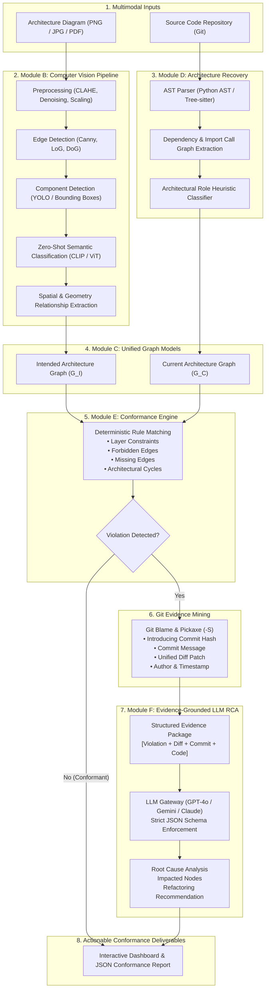

# ArchLens 🔍

[](https://www.python.org/)
[](https://fastapi.tiangolo.com/)
[](https://react.dev/)
[](https://vitejs.dev/)
[](https://tailwindcss.com/)
[](backend/tests/)
[](LICENSE)

> **Architecture Conformance Checking with Computer Vision, Static Program Analysis, and Evidence-Grounded LLM Reasoning**

---

## 📖 Table of Contents
- [Executive Overview](#-executive-overview)
- [The Core Design Principle](#-the-core-design-principle)
- [System Architecture](#-system-architecture)
- [Core Modules Breakdown](#-core-modules-breakdown)
- [Technology Stack](#-technology-stack)
- [Project Directory Structure](#-project-directory-structure)
- [Getting Started / How to Run](#-getting-started--how-to-run)
  - [Prerequisites](#prerequisites)
  - [1. Backend Setup](#1-backend-setup)
  - [2. Frontend Setup](#2-frontend-setup)
  - [3. Running via Docker Compose](#3-running-via-docker-compose)
  - [4. Running Automated Tests](#4-running-automated-tests)
- [API Reference](#-api-reference)
- [Verdict Taxonomy & Example Report](#-verdict-taxonomy--example-report)
- [50-Day Scrum Roadmap](#-50-day-scrum-roadmap)
- [Research Questions & Evaluation](#-research-questions--evaluation)
- [Team & Contribution](#-team--contribution)

---

## 🌟 Executive Overview

Software architecture inevitably erodes over time as features are added and deadlines loom: controllers directly query databases, layering boundaries dissolve, and circular dependencies proliferate. 

Existing solutions either:
1. Require manual rule authoring in proprietary DSLs (e.g., ArchUnit), or
2. Attempt to feed entire codebases into LLMs, resulting in hallucinations, token limits, and nondeterministic verdicts.

**ArchLens** solves this by establishing a multimodal, evidence-grounded conformance pipeline:
- **Vision for Design Intent**: Converts visual architecture diagrams (UML, microservices, C4 models) into a formal **Intended Architecture Graph ($G_I$)** using Computer Vision (OpenCV, YOLO, ViT, CLIP zero-shot classification).
- **Static Analysis for Structural Truth**: Deterministically parses codebases using **Abstract Syntax Trees (AST)** and dependency extraction to recover the **Current Architecture Graph ($G_C$)**.
- **Graph Rules for Deterministic Verdicts**: Performs graph comparison and applies architectural constraints to issue explicit verdicts (`CONFORMANT`, `VIOLATION`, `MISSING`, `UNEXPECTED`, `UNCERTAIN`).
- **LLM for Evidence-Grounded Semantic Reasoning**: Automatically mines Git history (`git blame`, `git log -S`, `git diff`) to isolate the exact commit that introduced the violation, feeding an evidence package to an LLM to explain the root cause, quantify component blast radius, and recommend architectural remediation.

---

## 🔒 The Core Design Principle

> **"The LLM must never be the final authority on a deterministic architectural fact."**

```
Does Module A import Module B?   ───►  DETERMINISTIC STATIC ANALYSIS (AST)
Is the architecture violated?     ───►  DETERMINISTIC GRAPH RULES (NetworkX)
Which commit broke the rule?      ───►  DETERMINISTIC GIT PICKAXE (GitPython)
Why was this change introduced?   ───►  LLM SEMANTIC REASONING (Evidence-Grounded)
How should it be refactored?      ───►  LLM ARCHITECTURAL RECOMMENDATION
```

This strict separation guarantees reproducible scientific results, eliminates hallucinated dependencies, and produces explainable architectural conformance reports.

---

## 🏛️ System Architecture



---

## 🧩 Core Modules Breakdown

| Module | Code Location | Responsibility |
|---|---|---|
| **Module A** | `backend/app/schemas/` | Unified JSON schemas for components, edges, graphs, violations, and Git evidence. |
| **Module B** | `backend/app/modules/cv_pipeline/` | Image preprocessing (CLAHE, scaling), edge detection (Canny/LoG/DoG), YOLO object detection, and CLIP zero-shot classification. |
| **Module C** | `backend/app/modules/graph/` | Unified Graph Data Model converting vision and static outputs into NetworkX directed graphs. |
| **Module D** | `backend/app/modules/architecture_recovery/` | Static program analysis using Python AST and Tree-sitter for deterministic dependency extraction. |
| **Module E** | `backend/app/modules/conformance_engine/` | Deterministic graph comparison against layered architecture rules and cycle detection algorithms. |
| **Git Evidence** | `backend/app/modules/git_evidence/` | Git blame, commit history mining, and pickaxe (`git log -S`) extraction of introducing diffs. |
| **Module F** | `backend/app/modules/llm_rca/` | Multi-provider LLM Gateway (OpenAI, Gemini, Anthropic) generating evidence-grounded root causes and recommendations. |
| **Module G** | `backend/app/modules/evaluation/` | Baseline comparisons (LLM-only, Static-only, CV-only), ablations, and precision/recall/F1 metrics. |

---

## 💻 Technology Stack

### Backend & Machine Learning
- **Framework:** FastAPI 0.115+, Uvicorn (ASGI)
- **Data Modeling & Settings:** Pydantic v2, Pydantic-Settings
- **Computer Vision & Deep Learning:** OpenCV 4.10, PyTorch 2.5, Torchvision, Pillow, Scikit-Image, Ultralytics YOLOv8, OpenAI CLIP / HuggingFace Transformers
- **Program Analysis:** Python `ast` (built-in), `tree-sitter` 0.23+
- **Graph Analytics:** NetworkX 3.4+
- **Version Control Analysis:** GitPython 3.1+
- **LLM Providers:** OpenAI API (`gpt-4o`), Google Generative AI (`gemini-1.5-pro`/`gemini-2.0-flash`), Anthropic SDK (`claude-3-5-sonnet`)
- **Resilience:** Tenacity (exponential backoff retry policies)
- **Testing:** Pytest 8.3+, pytest-asyncio, pytest-cov

### Frontend Dashboard
- **Library:** React 18
- **Tooling & Bundler:** Vite 6
- **Styling:** TailwindCSS 3.4, PostCSS, Autoprefixer
- **Icons:** Lucide React
- **Client Routing:** React Router DOM v6
- **Server State & Data Fetching:** TanStack React Query v5, Axios
- **Graph Visualization:** ReactFlow, Recharts

### Infrastructure & DevOps
- **Containerization:** Docker, Docker Compose
- **Database Support:** SQLite (default local) / PostgreSQL 16 (via Docker)
- **CI/CD:** GitHub Actions ready

---

## 📁 Project Directory Structure

```
ArchLens/
├── .gitignore                      # Git ignore rules for Python, Node, data, and models
├── README.md                       # Main project documentation
├── docker-compose.yml              # Multi-service container orchestration
├── docs/                           # Project requirements, roadmap & technical specs
│   ├── ArchLens_50_Day_Scrum_Document (1).docx   # 50-Day Scrum Plan
│   ├── ArchLens_Implementation_Design.docx       # Implementation & Research Design
│   ├── PROJECT_SETUP_REPORT.md                   # Full setup & verification report
│   ├── api/                                      # API specifications
│   └── research/                                 # Research notes & benchmarks
├── backend/                        # Python FastAPI Backend
│   ├── .env.example                # Example environment variables
│   ├── Dockerfile                  # Production container definition
│   ├── pyproject.toml              # Build & pytest configuration
│   ├── requirements.txt            # Python dependencies
│   ├── venv/                       # Virtual environment (Python 3.13)
│   ├── app/
│   │   ├── main.py                 # Application entry point & router registration
│   │   ├── api/routes/             # REST route handlers
│   │   │   ├── diagram.py          # POST /api/v1/analyze-diagram
│   │   │   ├── repository.py       # POST /api/v1/analyze-repository
│   │   │   ├── conformance.py      # POST /api/v1/check-conformance
│   │   │   ├── violations.py       # POST /api/v1/analyze-violation
│   │   │   └── reports.py          # GET  /api/v1/report/{id}
│   │   ├── core/
│   │   │   └── config.py           # Application settings & environment parsing
│   │   ├── modules/                # Architecture modules (Modules B through F)
│   │   │   ├── cv_pipeline/        # Image processing, YOLO & CLIP
│   │   │   ├── architecture_recovery/ # AST parsing & dependency extraction
│   │   │   ├── conformance_engine/ # Graph rules & cycle detection
│   │   │   ├── git_evidence/       # Git blame, diff & pickaxe extractor
│   │   │   ├── llm_rca/            # LLM Gateway & structured RCA
│   │   │   ├── graph/              # Unified graph representations
│   │   │   └── evaluation/         # Benchmark evaluation & metrics
│   │   ├── schemas/
│   │   │   └── models.py           # Pydantic data schemas
│   │   └── utils/                  # Shared helper utilities
│   └── tests/                      # Automated test suite
│       └── unit/
│           └── test_conformance_engine.py  # Conformance engine unit tests
├── frontend/                       # React 18 + Vite Web Dashboard
│   ├── index.html                  # Web entry point
│   ├── package.json                # Node dependencies & npm scripts
│   ├── vite.config.js              # Vite server & API proxy config
│   ├── tailwind.config.js          # Tailwind CSS theme configuration
│   ├── postcss.config.js           # PostCSS configuration
│   └── src/
│       ├── main.jsx                # React DOM render root
│       ├── App.jsx                 # Client-side router definition
│       ├── index.css               # Global Tailwind stylesheet
│       ├── components/
│       │   └── Layout.jsx          # Dashboard shell with sidebar navigation
│       ├── pages/
│       │   ├── Dashboard.jsx       # Overview, metrics & status cards
│       │   ├── DiagramAnalysis.jsx # Diagram upload & CV inspector
│       │   ├── RepositoryAnalysis.jsx # Source repository AST scanner
│       │   └── ConformanceReport.jsx  # Violation & RCA inspector
│       └── services/
│           └── api.js              # Centralized Axios API client
├── data/                           # Data directory
│   ├── annotations/                # Diagram bounding box annotations
│   ├── benchmarks/                 # Curated benchmark repositories
│   ├── datasets/                   # ArchEval & SAR datasets
│   ├── diagrams/                   # Input architecture diagrams
│   ├── repositories/               # Cloned candidate repositories
│   └── uploads/                    # Uploaded diagram cache
└── experiments/                    # Research experiment tracking
    ├── ablations/                  # Ablation trial results
    ├── baselines/                  # Baseline configurations
    └── results/                    # Metric tables & confusion matrices
```

---

## 🚀 Getting Started / How to Run

### Prerequisites
- **Python**: Version `3.10` or higher (`3.13` recommended)
- **Node.js**: Version `18.x` or higher (`v24` verified)
- **Git**: Installed and available in your shell `PATH`
- *(Optional)* **Docker & Docker Compose**: For containerized deployment

---

### 1. Backend Setup

1. **Navigate to the backend directory:**
   ```bash
   cd backend
   ```

2. **Create and activate a virtual environment:**
   - **Windows (PowerShell):**
     ```powershell
     python -m venv venv
     .\venv\Scripts\Activate.ps1
     ```
   - **macOS / Linux:**
     ```bash
     python3 -m venv venv
     source venv/bin/activate
     ```

3. **Install dependencies:**
   ```bash
   pip install -r requirements.txt
   ```

4. **Configure environment variables:**
   ```bash
   cp .env.example .env
   ```
   Edit `.env` to supply your API keys if performing LLM-based root cause analysis:
   ```env
   OPENAI_API_KEY=sk-...
   GOOGLE_API_KEY=AIza...
   ANTHROPIC_API_KEY=sk-ant-...
   ```

5. **Start the FastAPI development server:**
   ```bash
   uvicorn app.main:app --reload --host 0.0.0.0 --port 8000
   ```
   - **Interactive API Documentation (Swagger UI):** [`http://localhost:8000/docs`](http://localhost:8000/docs)
   - **Alternative ReDoc UI:** [`http://localhost:8000/redoc`](http://localhost:8000/redoc)

---

### 2. Frontend Setup

1. **Open a new terminal and navigate to the frontend directory:**
   ```bash
   cd frontend
   ```

2. **Install npm packages:**
   ```bash
   npm install
   ```

3. **Start the Vite development server:**
   ```bash
   npm run dev
   ```
   Open your browser at: [`http://localhost:5173`](http://localhost:5173)

4. **(Optional) Build for production:**
   ```bash
   npm run build
   ```
   Production artifacts will be generated in `frontend/dist/`.

---

### 3. Running via Docker Compose

To run the complete ecosystem (Backend + Frontend + PostgreSQL) in isolated containers:
```bash
docker-compose up --build
```
- Frontend: `http://localhost:3000`
- Backend API: `http://localhost:8000`
- PostgreSQL: `localhost:5432`

---

### 4. Running Automated Tests

To run the test suite verifying graph rules, layer constraints, cycle detection, and conformance checks:

```powershell
cd backend
.\venv\Scripts\pytest
```

**Expected output:**
```
tests/unit/test_conformance_engine.py::test_conformant_graph PASSED          [ 20%]
tests/unit/test_conformance_engine.py::test_forbidden_dependency_detected PASSED [ 40%]
tests/unit/test_conformance_engine.py::test_missing_dependency_detected PASSED [ 60%]
tests/unit/test_conformance_engine.py::test_cycle_detection PASSED           [ 80%]
tests/unit/test_conformance_engine.py::test_summary_counts PASSED            [100%]
============================== 5 passed in 1.29s ==============================
```

---

## 📡 API Reference

| Method | Endpoint | Description |
|---|---|---|
| `POST` | `/api/v1/analyze-diagram` | Upload a diagram image; runs the CV pipeline to extract intended graph $G_I$. |
| `POST` | `/api/v1/analyze-repository` | Supply a repo path; runs AST parser to extract current graph $G_C$. |
| `POST` | `/api/v1/check-conformance/inline` | Compare $G_I$ and $G_C$ inline to detect violations and cycle anomalies. |
| `POST` | `/api/v1/analyze-violation` | Mine Git history for an introducing commit and run evidence-grounded LLM RCA. |
| `GET` | `/api/v1/report/{id}` | Retrieve a stored conformance audit report. |
| `GET` | `/health` | Service health status check. |

---

## 📊 Verdict Taxonomy & Example Report

### Conformance Verdict Taxonomy
- **`CONFORMANT`**: Implementation strictly satisfies all intended design rules.
- **`VIOLATION`**: Implementation introduces an explicitly forbidden dependency (e.g. Layer bypass).
- **`MISSING`**: An architectural relationship defined in $G_I$ is missing in $G_C$.
- **`UNEXPECTED`**: An implementation relationship exists that is not documented in $G_I$.
- **`UNCERTAIN`**: Ambiguous mapping between visual diagram component and code module.

### Sample Conformance Report Output
```json
{
  "verdict": "VIOLATION",
  "violation": {
    "type": "layer_violation",
    "source": "OrderController",
    "target": "OrderRepository",
    "severity": "high",
    "expected": "OrderController -> OrderService -> OrderRepository",
    "actual": "OrderController -> OrderRepository (direct bypass)"
  },
  "git_evidence": {
    "introducing_commit": "7a9f2bc",
    "author": "dev@example.com",
    "message": "Quick fix: fetch orders directly for checkout optimization",
    "diff_snippet": "+ from app.repositories import OrderRepository"
  },
  "llm_rca": {
    "violation_explanation": "OrderController directly imports OrderRepository, bypassing the Service layer and violating layered architecture constraints.",
    "root_cause": "Commit 7a9f2bc introduced direct repository access to optimize checkout speed without routing through OrderService.",
    "affected_components": ["OrderController", "OrderService", "OrderRepository"],
    "recommendation": "Inject OrderService into OrderController and expose a dedicated service method to preserve domain encapsulation.",
    "confidence": 0.96
  }
}
```

---

## 📅 50-Day Scrum Roadmap

ArchLens follows a 10-sprint Scrum framework (5 days per sprint):

| Sprint | Days | Focus Area | Deliverables |
|---|---|---|---|
| **Sprint 1** | Days 1–5 | **Foundation & Schemas** | Architecture schemas, unified data models, repo structure, test suite *(Done)* |
| **Sprint 2** | Days 6–10 | **CV Preprocessing & AST Ingestion** | Image normalization, edge detection baselines, Python AST pipeline |
| **Sprint 3** | Days 11–15 | **Component Detection & Recovery** | YOLO diagram baseline, class/import call graph construction |
| **Sprint 4** | Days 16–20 | **Segmentation & Architecture Graphs** | U-Net mask generation, confidence scoring, NetworkX graph pipelines |
| **Sprint 5** | Days 21–25 | **VLM, ViT, CLIP & Relationship Extraction** | CLIP zero-shot classification, geometric arrow analysis, edge candidate matching |
| **Sprint 6** | Days 26–30 | **Conformance Engine Integration** | Graph alignment, deterministic rule validation, verdict classification |
| **Sprint 7** | Days 31–35 | **Git Evidence & LLM RCA** | Git blame/diff/pickaxe packaging, evidence-grounded prompt templates |
| **Sprint 8** | Days 36–40 | **Impact Analysis & Recommendations** | Graph traversal blast radius detection, architectural refactoring advice |
| **Sprint 9** | Days 41–45 | **Evaluation, Baselines & Ablations** | Precision/Recall/F1 metrics across CV, Static, and Hybrid configurations |
| **Sprint 10** | Days 46–50 | **Final Integration, Paper & Demo** | Benchmarking results, research paper figures, live demonstration |

---

## 🔬 Research Questions & Evaluation

- **RQ1 (Diagram Extraction Accuracy):** How accurately can components and relationships be extracted from architectural diagrams using Computer Vision / VLM methods?
- **RQ2 (Graph Alignment):** How reliably can visual architectural components be aligned to actual code modules?
- **RQ3 (Conformance Accuracy):** Does combining deterministic static analysis with semantic LLM reasoning reduce false positive violation reports compared to pure LLM approaches?
- **RQ4 (RCA Localization):** Does augmenting the LLM with Git pickaxe history and dependency graphs improve root-cause localization accuracy (Top-1, Top-k)?
- **RQ5 (Evidence Contribution):** Which evidence source (AST, Git diff, commit message, diagram geometry) contributes most to explainable architectural fixes?

---

## 👥 Team & Contribution

ArchLens is built by a 4-member research team:
- **P1:** Computer Vision Pipeline Lead (YOLO, U-Net, Image Preprocessing)
- **P2:** Vision-Language & Prompting Lead (VLM, CLIP, LLM RCA Prompt Engineering)
- **P3:** Static Analysis & Graph Lead (AST, Tree-sitter, Conformance Rules, NetworkX)
- **P4:** Backend, Integration & Dashboard Lead (FastAPI, React Dashboard, Git Mining)

---

## 📄 License
This project is licensed under the [MIT License](LICENSE).
